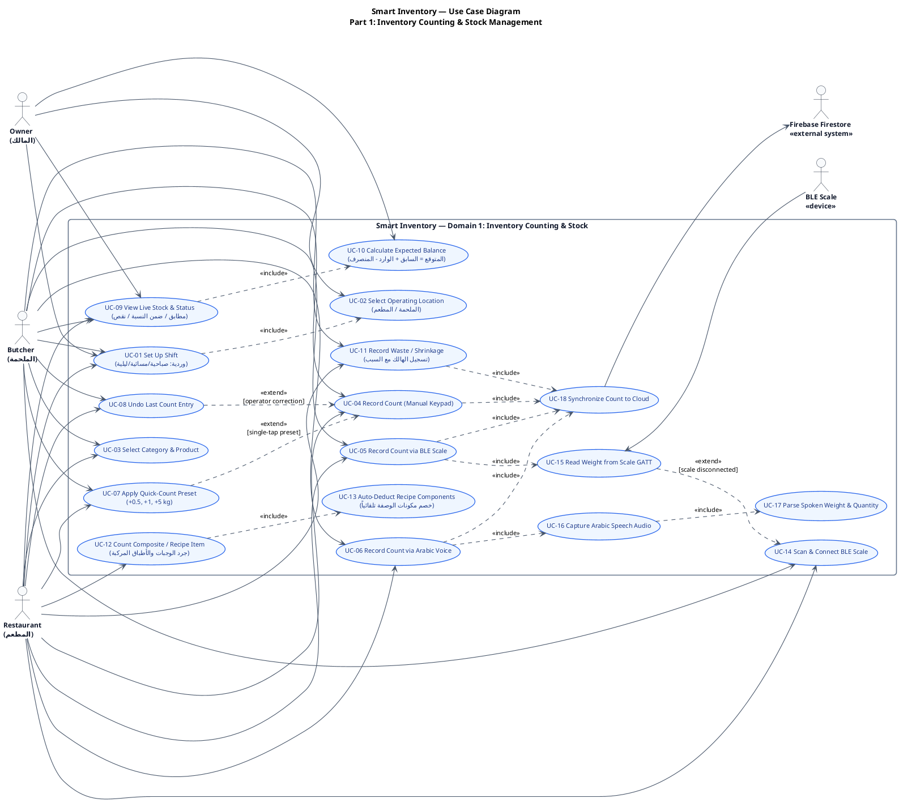
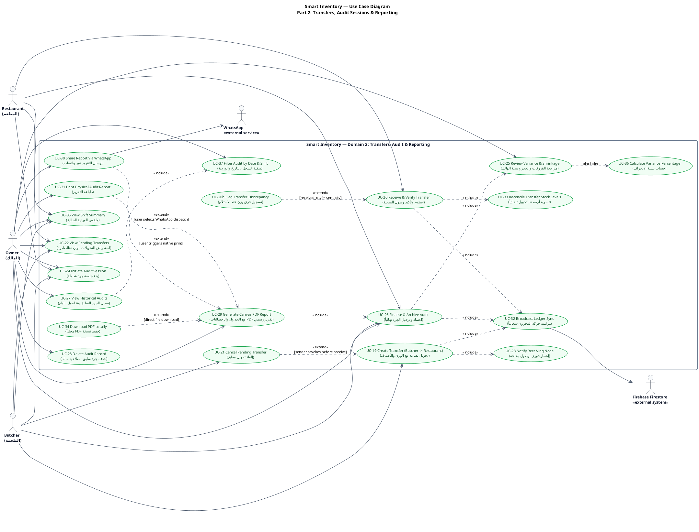
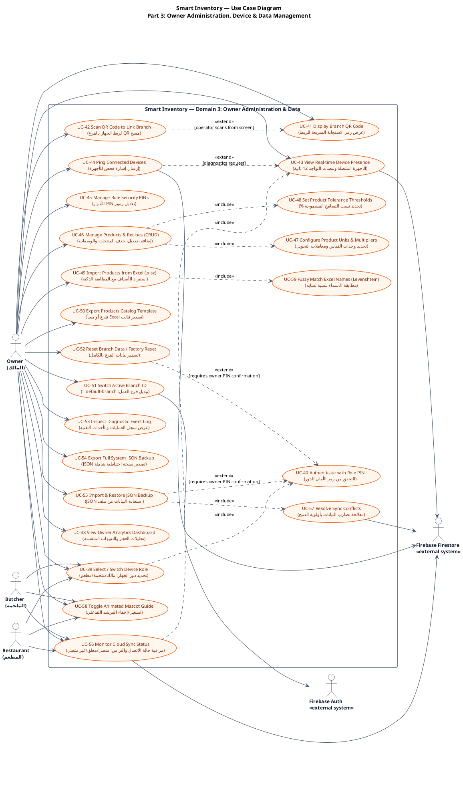

# Deliverable 2 — Use Case Diagram Specification

> **Document**: `ai-system-diagrams/02-use-case-diagram.md`  
> **System**: Smart Inventory Movement and Counting System (نظام حركة وجرد المخزون)  
> **Standard**: UML 2.5 Superstructure (ISO/IEC 19505-2)  
> **Traceability**: Derived from `ai-system-diagrams/01-requirements.md` (FR-01 to FR-52, NFR-01 to NFR-25)  
> **Date**: 2026-11-22  
> **Version**: 1.0  

---

## 1. Architectural Context & System Boundary

The **Smart Inventory Movement and Counting System** is an offline-first, dual-location inventory management platform operating across Butcher (`butcher` / الملحمة) and Restaurant (`restaurant` / المطعم) nodes, supervised by an Owner (`owner` / المالك) role. The system boundary encompasses local reactive UI flows, indexed local storage (IndexedDB/SQLite), hardware peripheral integration (Bluetooth LE Weight Scale, Web/Capacitor Speech Recognition), client-side reporting engines (Canvas + jsPDF), and an asynchronous cloud synchronization bridge (Firebase Firestore & Firebase Auth).

```
+-------------------------------------------------------------------------------------------------------+
|                                    SYSTEM BOUNDARY: SMART INVENTORY                                    |
|                                                                                                       |
|  [Part 1: Counting & Stock]          [Part 2: Transfers & Audit]          [Part 3: Owner & System]     |
|  - Shift Setup (UC-01)               - Create Transfer (UC-19)            - Role Switch & PIN (UC-39)  |
|  - Catalog Navigation (UC-03)        - Receive Transfer (UC-20)           - Product CRUD (UC-46)       |
|  - Manual / BLE / Voice Count        - Discrepancy Flagging (UC-20b)      - Excel Import (UC-49)       |
|    (UC-04, UC-05, UC-06)             - Cancel Transfer (UC-21)            - Role PIN Config (UC-51)    |
|  - Quick-Count Presets (UC-07)       - Audit Initiation (UC-24)           - Branch Switch (UC-52)      |
|  - Composite Auto-Deduct (UC-12/13)  - Discrepancy Review (UC-25)         - JSON Backup/Restore (UC-54)|
|  - Waste Registration (UC-11)        - Audit Finalization (UC-26)         - Cloud Sync Control (UC-56) |
|  - Hardware Scale Link (UC-14/15)    - PDF Report Build (UC-29)           - Analytics Dashboard (UC-38)|
|                                      - WhatsApp Dispatch (UC-30)                                      |
+-------------------------------------------------------------------------------------------------------+
         ^                                  ^                                  ^
         |                                  |                                  |
   [BLE Scale]                    [Firebase Firestore]                 [WhatsApp Web API]
  (GATT 0x181D)                  (Real-time onSnapshot)                 (wa.me Protocol)
```

---

## 2. Actor Taxonomy & Profiles

### 2.1 Primary Actors (Human Roles)

| Actor | Canonical Role Name | Arabic Identifier | Code Reference | Description & Permissions |
|---|---|---|---|---|
| **Butcher** | `butcher` | الملحمة | `src/models.ts#L4`, `src/App.tsx#L400` | Operates butcher station. Performs counting, records meat/poultry cuts, initiates transfers to restaurant, records waste, views local balance. |
| **Restaurant** | `restaurant` | المطعم | `src/models.ts#L4`, `src/App.tsx#L400` | Operates kitchen/restaurant station. Receives transfers from butcher, flags delivery discrepancies, counts recipe/composite items with auto-deduction. |
| **Owner** | `owner` | المالك | `src/models.ts#L4`, `src/App.tsx#L400` | Administrative supervisor. Full access: modifies catalog, sets PINs, reviews shrinkage/variance, imports Excel sheets, configures branches, triggers backups. |

### 2.2 Secondary Actors (External Hardware & Cloud Systems)

| Actor | Stereotype | Protocol / Standard | Code Reference | Functional Purpose |
|---|---|---|---|---|
| **BLE Scale** | `«device»` | Bluetooth LE GATT Service `0x181D` (Weight Measurement), Char `0x2A9D` | `src/features/bleScale.ts#L6-L10` | Hardware peripheral transmitting raw weight measurements to counting flow. |
| **Speech Engine** | `«device»` / `«service»` | Web Speech API (`webkitSpeechRecognition`) / Capacitor Speech Recognition | `src/features/speechRecognition.ts#L7` | Captures spoken Arabic phonetic input and parses numbers/units for hands-free counting. |
| **Firebase Firestore** | `«external system»` | Google Cloud Firestore REST / WebSocket SDK (`onSnapshot`) | `src/data/firebaseInventorySync.ts#L18` | Distributed cloud database synchronizing state across branch devices with 250ms batching. |
| **Firebase Auth** | `«external system»` | Firebase Auth (Anonymous & Email/Password Tokens) | `src/data/firebase/authService.ts#L10` | Establishes authenticated cloud session and tenant isolation for branch data. |
| **WhatsApp Service** | `«external service»` | HTTPS `https://wa.me/?text=...` URI Scheme | `src/features/pdfDelivery.ts#L6` | External communication rail dispatching audit summaries and pre-formatted text reports. |

---

## 3. Sub-Diagram 1: Inventory Counting & Stock Management (Part 1 of 3)

### 3.1 Scope & Codebase Anchor
- **File**: `ai-system-diagrams/plantuml/use-case.puml`
- **Rendered Output**: `ai-system-diagrams/plantuml/output/use-case.svg`
- **Core Modules**: `src/App.tsx`, `src/features/bleScale.ts`, `src/features/speechRecognition.ts`, `src/features/compositeInventory.ts`, `src/inventoryCatalog.ts`

### 3.2 Diagram Specification (PlantUML)



---

## 4. Sub-Diagram 2: Transfers, Audit & Reporting (Part 2 of 3)

### 4.1 Scope & Codebase Anchor
- **File**: `ai-system-diagrams/plantuml/use-case-part2-transfers-audit.puml`
- **Rendered Output**: `ai-system-diagrams/plantuml/output/use-case-part2-transfers-audit.svg`
- **Core Modules**: `src/App.tsx`, `src/AuditHistory.tsx`, `src/PdfReport.tsx`, `src/features/pdfDelivery.ts`, `src/data/inventoryDataService.ts`

### 4.2 Diagram Specification (PlantUML)



---

## 5. Sub-Diagram 3: Owner Administration, Device & Data Management (Part 3 of 3)

### 5.1 Scope & Codebase Anchor
- **File**: `ai-system-diagrams/plantuml/use-case-part3-owner-admin.puml`
- **Rendered Output**: `ai-system-diagrams/plantuml/output/use-case-part3-owner-admin.svg`
- **Core Modules**: `src/App.tsx`, `src/OwnerAnalytics.tsx`, `src/DataBackup.tsx`, `src/DeviceConnectModal.tsx`, `src/features/productImport.ts`, `src/data/firebaseInventorySync.ts`, `src/data/firebase/authService.ts`

### 5.2 Diagram Specification (PlantUML)



---

## 6. Complete Use Case Catalog (UC-01 through UC-59)

| UC ID | Use Case Name | Primary Actor(s) | Secondary Actor(s) | Mapped FR / NFR | Code Anchor |
|---|---|---|---|---|---|
| **UC-01** | Set Up Shift | Butcher, Restaurant, Owner | — | FR-01, NFR-21 | `src/ShiftSetup.tsx#L18` |
| **UC-02** | Select Operating Location | Butcher, Restaurant, Owner | — | FR-02, NFR-06 | `src/App.tsx#L420` |
| **UC-03** | Select Category & Product | Butcher, Restaurant | — | FR-04, NFR-21 | `src/App.tsx#L1250` |
| **UC-04** | Record Count (Manual Keypad) | Butcher, Restaurant | — | FR-05, NFR-01 | `src/App.tsx#L1410` |
| **UC-05** | Record Count via BLE Scale | Butcher, Restaurant | BLE Scale | FR-06, NFR-02 | `src/features/bleScale.ts#L42` |
| **UC-06** | Record Count via Voice | Butcher, Restaurant | Speech Engine | FR-07, NFR-22 | `src/features/speechRecognition.ts#L65` |
| **UC-07** | Apply Quick-Count Preset | Butcher, Restaurant | — | FR-08, NFR-21 | `src/App.tsx#L1480` |
| **UC-08** | Undo Last Count Entry | Butcher, Restaurant | — | FR-09, NFR-21 | `src/App.tsx#L1530` |
| **UC-09** | View Live Stock & Status | Butcher, Restaurant, Owner | — | FR-10, NFR-01 | `src/features/inventoryStatus.ts#L22` |
| **UC-10** | Calculate Expected Balance | Owner, Butcher | — | FR-11, NFR-01 | `src/inventoryCatalog.ts#L340` |
| **UC-11** | Record Waste / Shrinkage | Butcher, Restaurant | — | FR-12, NFR-11 | `src/data/inventoryDataService.ts#L410` |
| **UC-12** | Count Composite Item | Restaurant | — | FR-13, NFR-11 | `src/features/compositeInventory.ts#L15` |
| **UC-13** | Auto-Deduct Components | Restaurant | — | FR-14, NFR-11 | `src/features/compositeInventory.ts#L48` |
| **UC-14** | Scan & Connect BLE Scale | Butcher, Restaurant | BLE Scale | FR-15, NFR-16 | `src/ScaleConnection.tsx#L35` |
| **UC-15** | Read Weight from Scale GATT | Butcher, Restaurant | BLE Scale | FR-16, NFR-02 | `src/features/bleScale.ts#L88` |
| **UC-16** | Capture Arabic Speech Audio | Butcher, Restaurant | Speech Engine | FR-17, NFR-22 | `src/features/speechRecognition.ts#L28` |
| **UC-17** | Parse Spoken Weight & Unit | Butcher, Restaurant | — | FR-18, NFR-22 | `src/features/speechRecognition.ts#L102` |
| **UC-18** | Synchronize Count to Cloud | Butcher, Restaurant | Firestore | FR-19, NFR-03 | `src/data/firebaseInventorySync.ts#L110` |
| **UC-19** | Create Transfer (Outbound) | Butcher | Firestore | FR-20, NFR-03 | `src/data/inventoryDataService.ts#L520` |
| **UC-20** | Receive & Verify Transfer | Restaurant | Firestore | FR-21, NFR-03 | `src/data/inventoryDataService.ts#L590` |
| **UC-20b** | Flag Transfer Discrepancy | Restaurant | Firestore | FR-22, NFR-11 | `src/data/inventoryDataService.ts#L615` |
| **UC-21** | Cancel Pending Transfer | Butcher | Firestore | FR-23, NFR-11 | `src/data/inventoryDataService.ts#L650` |
| **UC-22** | View Pending Transfers | Butcher, Restaurant, Owner | — | FR-24, NFR-21 | `src/App.tsx#L2100` |
| **UC-23** | Notify Receiving Node | Butcher, Restaurant | Firestore | FR-25, NFR-03 | `src/data/firebaseInventorySync.ts#L240` |
| **UC-24** | Initiate Audit Session | Butcher, Restaurant, Owner | — | FR-26, NFR-11 | `src/App.tsx#L2650` |
| **UC-25** | Review Variance & Shrinkage | Owner, Butcher | — | FR-27, NFR-01 | `src/App.tsx#L2800` |
| **UC-26** | Finalise & Archive Audit | Owner, Butcher, Restaurant | Firestore | FR-28, NFR-11 | `src/data/inventoryDataService.ts#L780` |
| **UC-27** | View Historical Audits | Owner | — | FR-29, NFR-21 | `src/AuditHistory.tsx#L45` |
| **UC-28** | Delete Audit Record | Owner | Firestore | FR-30, NFR-06 | `src/data/inventoryDataService.ts#L860` |
| **UC-29** | Generate Canvas PDF Report | Owner | — | FR-31, NFR-04 | `src/PdfReport.tsx#L55` |
| **UC-30** | Share Report via WhatsApp | Owner | WhatsApp | FR-32, NFR-23 | `src/features/pdfDelivery.ts#L35` |
| **UC-31** | Print Physical Audit Report | Owner | — | FR-33, NFR-21 | `src/features/pdfDelivery.ts#L68` |
| **UC-32** | Broadcast Ledger Sync | Butcher, Restaurant, Owner | Firestore | FR-34, NFR-03 | `src/data/firebaseInventorySync.ts#L180` |
| **UC-33** | Reconcile Transfer Stock | Restaurant | — | FR-35, NFR-11 | `src/data/inventoryDataService.ts#L630` |
| **UC-34** | Download PDF Locally | Owner | — | FR-36, NFR-21 | `src/PdfReport.tsx#L210` |
| **UC-35** | View Shift Summary | Butcher, Restaurant, Owner | — | FR-37, NFR-21 | `src/App.tsx#L3100` |
| **UC-36** | Calculate Variance Percentage | Owner | — | FR-38, NFR-01 | `src/features/inventoryStatus.ts#L55` |
| **UC-37** | Filter Audit by Date/Shift | Owner | — | FR-39, NFR-21 | `src/AuditHistory.tsx#L90` |
| **UC-38** | View Owner Analytics | Owner | — | FR-40, NFR-01 | `src/OwnerAnalytics.tsx#L25` |
| **UC-39** | Select / Switch Device Role | Butcher, Restaurant, Owner | — | FR-41, NFR-06 | `src/DeviceConnectModal.tsx#L40` |
| **UC-40** | Authenticate with Role PIN | Butcher, Restaurant, Owner | — | FR-42, NFR-06 | `src/DeviceConnectModal.tsx#L110` |
| **UC-41** | Display Branch QR Code | Owner | — | FR-43, NFR-21 | `src/DeviceConnectModal.tsx#L185` |
| **UC-42** | Scan QR Code to Link Branch | Butcher, Restaurant | — | FR-44, NFR-21 | `src/DeviceConnectModal.tsx#L220` |
| **UC-43** | View Device Presence (12s) | Owner | Firestore | FR-45, NFR-12 | `src/data/firebaseInventorySync.ts#L310` |
| **UC-44** | Ping Connected Devices | Owner | Firestore | FR-46, NFR-12 | `src/data/firebaseInventorySync.ts#L360` |
| **UC-45** | Manage Role Security PINs | Owner | Firestore | FR-47, NFR-06 | `src/data/inventoryDataService.ts#L940` |
| **UC-46** | Manage Products & Recipes | Owner | Firestore | FR-48, NFR-11 | `src/App.tsx#L4100` |
| **UC-47** | Configure Units & Multipliers | Owner | — | FR-49, NFR-11 | `src/inventoryCatalog.ts#L180` |
| **UC-48** | Set Tolerance Thresholds | Owner | — | FR-50, NFR-11 | `src/features/inventoryStatus.ts#L80` |
| **UC-49** | Import Products from Excel | Owner | — | FR-51, NFR-04 | `src/features/productImport.ts#L30` |
| **UC-50** | Export Catalog Template | Owner | — | FR-52, NFR-04 | `src/features/productImport.ts#L185` |
| **UC-51** | Switch Active Branch ID | Owner | Firebase Auth | FR-02, NFR-07 | `src/data/firebase/authService.ts#L55` |
| **UC-52** | Reset Branch Data | Owner | Firestore | FR-03, NFR-13 | `src/data/inventoryDataService.ts#L1120` |
| **UC-53** | Inspect Diagnostic Event Log | Owner | — | FR-37, NFR-18 | `src/data/inventoryDataService.ts#L1250` |
| **UC-54** | Export JSON Backup | Owner | — | FR-38, NFR-13 | `src/DataBackup.tsx#L35` |
| **UC-55** | Import & Restore JSON Backup | Owner | Firestore | FR-39, NFR-13 | `src/DataBackup.tsx#L85` |
| **UC-56** | Monitor Cloud Sync Status | Butcher, Restaurant, Owner | Firestore | FR-19, NFR-14 | `src/data/firebaseInventorySync.ts#L85` |
| **UC-57** | Resolve Sync Conflicts | System | Firestore | FR-20, NFR-14 | `src/data/firebaseInventorySync.ts#L420` |
| **UC-58** | Toggle Animated Mascot Guide | Butcher, Restaurant, Owner | — | FR-41, NFR-24 | `src/MascotCompanion.tsx#L20` |
| **UC-59** | Fuzzy Match Excel Names | Owner | — | FR-51, NFR-04 | `src/features/productImport.ts#L120` |

---

## 7. UML 2.5 Semantic Relationships & Extension Points

### 7.1 `<<include>>` Dependencies (Mandatory Sub-flows)
1. **`UC-01 (Set Up Shift) ..> UC-02 (Select Location)`**: A shift cannot initialize without establishing whether the local terminal executes butcher or restaurant counting semantics.
2. **`UC-05 (BLE Scale Count) ..> UC-15 (Read Weight GATT)`**: Recording a count from hardware unconditionally invokes GATT weight characteristic reading.
3. **`UC-06 (Voice Count) ..> UC-16 (Capture Audio)`** and **`UC-16 ..> UC-17 (Parse Weight)`**: Spoken counting unconditionally executes speech recognition capture followed by numeric/unit regex and phonetic normalization.
4. **`UC-09 (View Status) ..> UC-10 (Calculate Expected Balance)`**: Color status badges (`matched`, `tolerance`, `shortage`) are derived directly from the expected stock formula.
5. **`UC-12 (Count Composite) ..> UC-13 (Auto-Deduct Components)`**: Recording a counted quantity of a recipe dish (e.g., burger patties) unconditionally deducts constituent raw items from inventory.
6. **`UC-19 (Create Transfer) ..> UC-23 (Notify Receiver)`**: Dispatching stock automatically writes pending transfer status to Firestore for real-time notification on the receiving device.
7. **`UC-20 (Receive Transfer) ..> UC-33 (Reconcile Stock)`**: Receiving items updates inbound balances and adjusts local stock.
8. **`UC-26 (Finalise Audit) ..> UC-25 (Review Variance)`**: Audits must pass through variance computation and verification before immutable persistence.
9. **`UC-49 (Import Excel) ..> UC-59 (Fuzzy Match Names)`**: Bulk catalog imports automatically execute Damerau-Levenshtein distance matching against existing products to prevent duplicates.

### 7.2 `<<extend>>` Dependencies (Conditional / Optional Flows)
1. **`UC-07 (Quick-Count Preset) ..> UC-04 (Record Count)`**: *Extension Point: Single-Tap Preset*. Triggers when the operator clicks quick-add increment pills (`+0.5`, `+1.0`, `+5.0`) instead of entering arbitrary keypad values.
2. **`UC-08 (Undo Last Count) ..> UC-04 (Record Count)`**: *Extension Point: Operator Correction*. Triggers when an erroneous count entry requires single-step rollback.
3. **`UC-15 (Read Weight) ..> UC-14 (Connect Scale)`**: *Extension Point: Scale Disconnected*. Triggers if GATT connection is lost during a read operation.
4. **`UC-20b (Flag Discrepancy) ..> UC-20 (Receive Transfer)`**: *Extension Point: Received Quantity Mismatch*. Triggers when `received_quantity != sent_quantity` (`TransferStatus = "Discrepancy"`).
5. **`UC-21 (Cancel Transfer) ..> UC-19 (Create Transfer)`**: *Extension Point: Revocation Prior to Receipt*. Triggers when the butcher rescinds a pending outbound shipment.
6. **`UC-30 (WhatsApp Dispatch) ..> UC-29 (Generate PDF Report)`**: *Extension Point: Social Channel Export*. Triggers when operator clicks "Send to WhatsApp" instead of saving locally.
7. **`UC-31 (Print Report) ..> UC-29 (Generate PDF Report)`**: *Extension Point: Hardcopy Output*. Triggers native window/Capacitor print preview.
8. **`UC-42 (Scan QR) ..> UC-41 (Display QR)`**: *Extension Point: Automated Branch Join*. Triggers when a secondary device pairs via camera scanner.
9. **`UC-52 (Reset Data) ..> UC-40 (Authenticate PIN)`**: *Extension Point: Privileged Authorization*. Triggers security challenge before destructive wipe.

---

## 8. Artifact & Verification Index

| Deliverable Artifact | Path | Format | Verification Status | Rendered Output |
|---|---|---|---|---|
| Part 1: Counting & Stock | `ai-system-diagrams/plantuml/use-case.puml` | PlantUML | Verified valid syntax | `ai-system-diagrams/plantuml/output/use-case.svg` |
| Part 2: Transfers & Audit | `ai-system-diagrams/plantuml/use-case-part2-transfers-audit.puml` | PlantUML | Verified valid syntax | `ai-system-diagrams/plantuml/output/use-case-part2-transfers-audit.svg` |
| Part 3: Owner & System | `ai-system-diagrams/plantuml/use-case-part3-owner-admin.puml` | PlantUML | Verified valid syntax | `ai-system-diagrams/plantuml/output/use-case-part3-owner-admin.svg` |
| High-Level Overview | `ai-system-diagrams/mermaid/use-case.mmd` | Mermaid | Verified with Pako deflater | `ai-system-diagrams/mermaid/output/use-case.svg` |
| Documentation Specification | `ai-system-diagrams/02-use-case-diagram.md` | Markdown | Fully code-grounded | Integrated |
